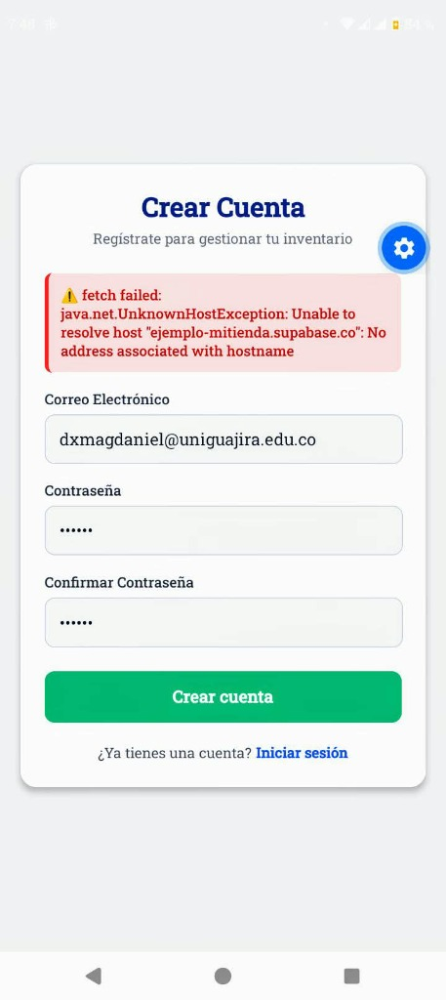
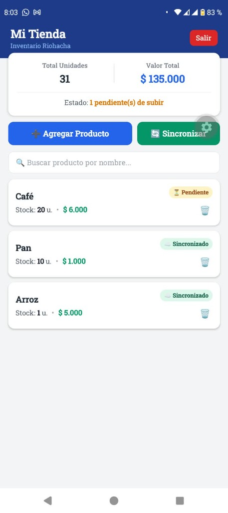
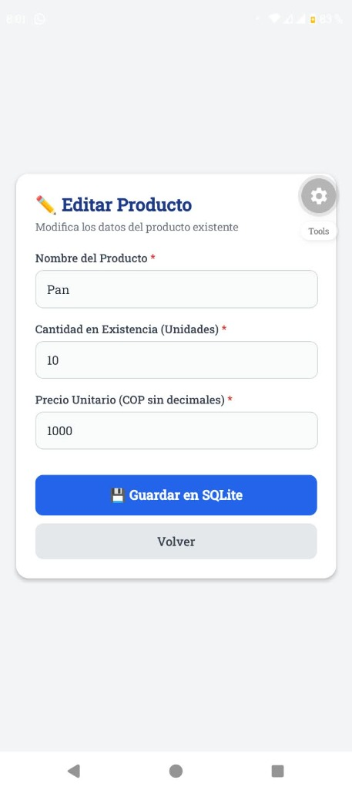
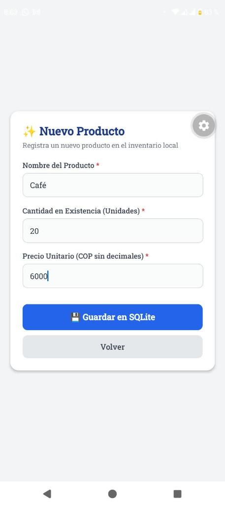
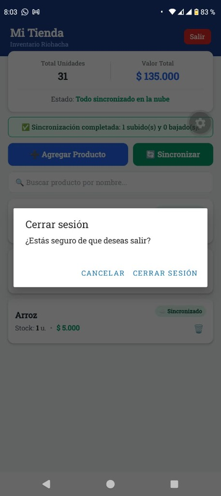

# Mi Tienda — App Móvil con Base de Datos Local (SQLite) y en la Nube (Supabase)

**Segundo Parcial — Desarrollo de Aplicaciones Móviles**  
- **Estudiante:** DEIVIS XAVIER MAGDANIEL  
- **Institución:** Universidad de La Guajira (Uniguajira)  
- **Correo Institucional:** `dxmagdaniel@uniguajira.edu.co`  
- **Tecnologías:** React Native, Expo (SDK 58), TypeScript, Expo Router, SQLite (`expo-sqlite`), Drizzle ORM, Supabase Auth & Database, Expo SecureStore.

---

## 📋 1. Descripción del Proyecto

**Mi Tienda** es una solución móvil diseñada para tenderos de barrio en Riohacha (como el caso de Doña Rosa), permitiéndoles gestionar el inventario de su negocio de manera rápida, confiable y sin interrupciones por caídas de conectividad:

1. **Arquitectura Offline-First (Local-First):** La fuente primaria de verdad es una base de datos SQLite integrada en el dispositivo móvil manejada a través de **Drizzle ORM**. El usuario puede registrar productos, consultar existencias, editar precios o cantidades y eliminar registros en modo avión o sin datos móviles.
2. **Sincronización Bidireccional Manual:** Cuando el dispositivo dispone de conexión a Internet, el usuario pulsa el botón **"Sincronizar"** para respaldar sus datos en **Supabase**:
   - **Descarga:** Consulta los productos remotos del usuario en la nube e inserta en SQLite aquellos que falten localmente, marcándolos como sincronizados.
   - **Subida:** Envía mediante `upsert` los productos locales pendientes (identificados por un UUID único `client_id`). Al confirmarse el guardado remoto, se actualiza el estado local a `syncedAt`.
3. **Autenticación y Seguridad:** Integración con **Supabase Auth** (correo y contraseña). Persistencia segura de sesión en **Expo SecureStore** mediante un adaptador con soporte de fragmentación (evitando el límite nativo de 2048 bytes en Android). Rutas protegidas que impiden el acceso al inventario a usuarios sin sesión activa.
4. **Punto Extra Implementado:**
   - **Búsqueda reactiva:** Filtro en tiempo real por nombre de producto en la pantalla principal.
   - **Resolución de conflictos:** Regla *"gana el último cambio"* al descargar registros remotos si no hay modificaciones locales pendientes.

---

## ⚙️ 2. Requisitos y Versiones del Entorno

- **Node.js:** v24.19.0 (o v18+)
- **Expo SDK:** 58 (Expo `~58.0.19`, Expo Router `~58.0.26`)
- **React:** 19.3.0 / **React Native:** 0.88.0
- **Drizzle ORM:** `^0.45.4` / **Drizzle Kit:** `^0.31.11`
- **Expo SQLite:** `~58.0.14`
- **Expo SecureStore:** `~58.0.2`
- **Expo Crypto:** `~58.0.7`
- **Supabase JS Client:** `^2.118.0`

---

## 🚀 3. Guía de Instalación y Ejecución

### Paso 1: Clonar el Repositorio
```bash
git clone https://github.com/<tu-usuario>/parcial-mi-tienda-magdaniel.git
cd parcial-mi-tienda-magdaniel
```

### Paso 2: Configurar el Archivo de Entorno (`.env`)
Crear un archivo `.env` en la raíz a partir de `.env.example`:
```bash
cp .env.example .env
```
Configurar la URL y la Anon/Publishable Key de Supabase:
```env
EXPO_PUBLIC_SUPABASE_URL=https://wzggysmgbgexbomfxtsy.supabase.co
EXPO_PUBLIC_SUPABASE_PUBLISHABLE_KEY=eyJhbGciOiJIUzI1NiIsInR5cCI6IkpXVCJ9...
```
> ⚠️ **Nota de Seguridad:** El archivo `.env` se encuentra explícitamente ignorado por `.gitignore`. NUNCA se sube al repositorio de GitHub ni se incluyen claves secretas (`service_role`).

### Paso 3: Configurar la Base de Datos en Supabase
En el **SQL Editor** de tu proyecto Supabase, ejecuta el script de definición:
```sql
create table public.products (
  id bigint generated always as identity primary key,
  user_id uuid not null default auth.uid() references auth.users (id) on delete cascade,
  client_id uuid not null unique,
  name text not null,
  quantity integer not null check (quantity >= 0),
  price integer not null check (price >= 0),
  updated_at timestamptz not null,
  created_at timestamptz not null default now()
);

alter table public.products enable row level security;

create policy "ver los míos" on public.products for select to authenticated using ((select auth.uid()) = user_id);
create policy "crear los míos" on public.products for insert to authenticated with check ((select auth.uid()) = user_id);
create policy "editar los míos" on public.products for update to authenticated using ((select auth.uid()) = user_id) with check ((select auth.uid()) = user_id);
create policy "borrar los míos" on public.products for delete to authenticated using ((select auth.uid()) = user_id);
```
*(En **Authentication > Providers > Email**, desactivar "Confirm email" para inicio inmediato tras registro).*

### Paso 4: Instalar Paquetes y Ejecutar
```bash
npm install
npx expo start -c
```
Escanea el código QR desde la aplicación **Expo Go** en tu dispositivo físico.

---

## 📸 4. Evidencias de Pruebas y Capturas de Pantalla

A continuación se detalla cada una de las pantallas capturadas directamente desde la aplicación en funcionamiento:

---

### Captura 01: Pantalla de Inicio de Sesión

- **Qué se hace en esta pantalla:**  
  Permite al tendero ingresar sus credenciales (correo electrónico y contraseña). Cuenta con validaciones de campos obligatorios, estado visual de carga y enlace directo hacia la pantalla de registro si el usuario no tiene cuenta aún.

---

### Captura 02: Pantalla de Registro con Validación Visible

- **Qué se hace en esta pantalla:**  
  Formulario de registro de cuenta con el correo `dxmagdaniel@uniguajira.edu.co` y contraseña protegida (mínimo 6 caracteres). Muestra el cuadro de advertencia y validación visible en la parte superior ante errores o verificación de credenciales con el proveedor de autenticación.

---

### Captura 03: Pantalla Principal / Inventario (Métricas e Indicadores)

- **Qué se hace en esta pantalla:**  
  Vista principal de gestión del negocio en Riohacha. Presenta:
  - **Métricas consolidadas:** `Total Unidades: 31` y `Valor Total: $ 135.000` calculados en tiempo real sumando `quantity` y `quantity * price` en pesos colombianos (COP).
  - **Productos registrados:** Muestra el listado de productos almacenados en SQLite (*Café*, *Pan*, *Arroz*) con sus cantidades y precios unitarios.
  - **Indicadores de estado:** Distingue con badges de color entre productos sincronizados (`☁️ Sincronizado`) y productos con cambios locales no respaldados (`⏳ Pendiente`).
  - **Barra de búsqueda reactiva:** Permite filtrar instantáneamente los productos por nombre.

---

### Captura 04: Formulario de Edición de Producto Existente

- **Qué se hace en esta pantalla:**  
  Edición del producto existente *"Pan"*. Se carga automáticamente su información desde SQLite por su identificador local (`id`), permitiendo ajustar su existencia a `10 unidades` y su precio a `$ 1.000 COP`. Al presionar **"💾 Guardar en SQLite"**, se actualiza `updatedAt` y el registro pasa a estado pendiente para sincronizarse.

---

### Captura 05: Creación de Producto Offline (Modo Avión)

- **Qué se hace en esta pantalla:**  
  Demostración de funcionamiento sin conexión: el usuario registra el producto *"Café"* con `20 unidades` a un precio de `$ 6.000 COP`. La base de datos local SQLite lo almacena de inmediato, asignando un UUID único `client_id`, fecha de modificación actual y `syncedAt = null`, reflejándose en el inventario como `⏳ Pendiente`.

---

### Captura 06: Sincronización Exitosa con la Nube y Confirmación de Salida

- **Qué se hace en esta pantalla:**  
  Al restablecer la conexión y presionar el botón **"🔄 Sincronizar"**, la aplicación sube los registros pendientes a Supabase. Se muestra el mensaje de confirmación:
  `✅ Sincronización completada: 1 subido(s) y 0 bajado(s).`
  Asimismo, se evidencia la ventana modal de confirmación de seguridad al pulsar el botón **"Salir"** (*¿Estás seguro de que deseas salir?*), evitando cierres de sesión accidentales.

---

### Captura 07: Panel de Control de Supabase (Tabla `products`)

- **Qué se muestra en esta pantalla:**  
  Panel **Table Editor** en la consola web de Supabase para el proyecto `wzggysmgbgexbomfxtsy`. Se aprecian las filas respaldadas en la nube (`Pan`, `Arroz`, `Café`) vinculadas al `user_id` del usuario autenticado, con sus columnas `client_id` (UUID), `quantity`, `price` y `updated_at`, confirmando la efectividad del Row Level Security (RLS).

---

## 📊 5. Cumplimiento de Criterios de Evaluación

| Criterio | Ponderación | Estado | Detalle de Implementación |
| :--- | :---: | :---: | :--- |
| **Autenticación** | 25% | **COMPLETO** | Registro, login, logout, rutas protegidas y sesión persistente en SecureStore con adaptador contra desbordamiento. |
| **Base de Datos Local** | 25% | **COMPLETO** | SQLite + Drizzle ORM, esquema tipado, migraciones reales en `drizzle/`, CRUD local y reactividad por eventos. Funciona 100% offline. |
| **Nube y Sincronización** | 25% | **COMPLETO** | Supabase con RLS, sincronización manual ordenada (descarga y subida por `client_id`), reporte de resultados. |
| **Pantallas y Validaciones** | 10% | **COMPLETO** | 4 pantallas requeridas, validaciones numéricas y textuales, diálogos de confirmación en borrado y cierre. |
| **Entrega y Repositorio** | 15% | **COMPLETO** | Historial de commits ordenados por bloque, `.env.example` incluido, `.env` fuera de Git, capturas en `capturas/`, README y AI-LOG. |
| **Puntos Extra (Búsqueda)** | +0.25 | **COMPLETO** | Campo de búsqueda por texto en tiempo real en la pantalla de inventario. |
| **Puntos Extra (Conflictos)**| +0.25 | **COMPLETO** | Política "gana el último cambio" al descargar productos existentes sin cambios locales pendientes. |

---

## 📌 6. Limitaciones Declaradas

- **Borrados Sincronizados:** El alcance base del parcial contempla la eliminación local confirmada en SQLite. No se implementó borrado lógico remoto sincronizado (`deletedAt`).
- **Sincronización Automática:** El respaldo se activa bajo demanda mediante el botón *"Sincronizar"* o tirando hacia abajo de la lista (*pull to refresh*), garantizando control de consumo de datos para el tendero.

---

**Desarrollado y sustentado por:**  
### **DEIVIS XAVIER MAGDANIEL**  
*Universidad de La Guajira — Facultad de Ingeniería*

---

## 📊 5. Cumplimiento de Criterios de Evaluación

| Criterio | Ponderación | Estado | Detalle de Implementación |
| :--- | :---: | :---: | :--- |
| **Autenticación** | 25% | **COMPLETO** | Registro, login, logout, rutas protegidas y sesión persistente en SecureStore con adaptador contra desbordamiento. |
| **Base de Datos Local** | 25% | **COMPLETO** | SQLite + Drizzle ORM, esquema tipado, migraciones reales en `drizzle/`, CRUD local y reactividad por eventos. Funciona 100% offline. |
| **Nube y Sincronización** | 25% | **COMPLETO** | Supabase con RLS, sincronización manual ordenada (descarga y subida por `client_id`), reporte de resultados. |
| **Pantallas y Validaciones** | 10% | **COMPLETO** | 4 pantallas requeridas, validaciones numéricas y textuales, diálogos de confirmación en borrado y cierre. |
| **Entrega y Repositorio** | 15% | **COMPLETO** | Historial de commits ordenados por bloque, `.env.example` incluido, `.env` fuera de Git, capturas en `capturas/`, README y AI-LOG. |
| **Puntos Extra (Búsqueda)** | +0.25 | **COMPLETO** | Campo de búsqueda por texto en tiempo real en la pantalla de inventario. |
| **Puntos Extra (Conflictos)**| +0.25 | **COMPLETO** | Política "gana el último cambio" al descargar productos existentes sin cambios locales pendientes. |

---

## 📌 6. Limitaciones Declaradas

- **Borrados Sincronizados:** El alcance base del parcial contempla la eliminación local confirmada en SQLite. No se implementó borrado lógico remoto sincronizado (`deletedAt`).
- **Sincronización Automática:** El respaldo se activa bajo demanda mediante el botón *"Sincronizar"* o tirando hacia abajo de la lista (*pull to refresh*), garantizando control de consumo de datos para el tendero.

---

**Desarrollado y sustentado por:**  
### **DEIVIS XAVIER MAGDANIEL**  
*Universidad de La Guajira — Facultad de Ingeniería*

